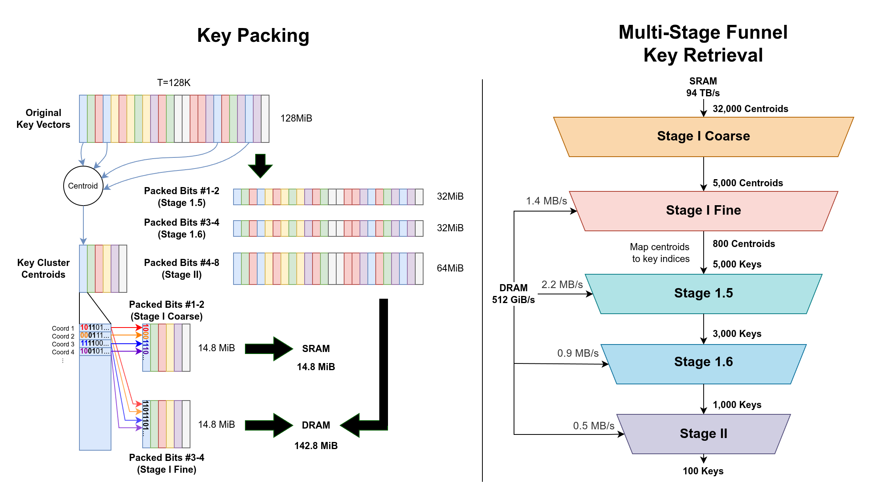

# SeoulKV4



A proof of concept for sparse decode attention on Tenstorrent Blackhole. It
runs the existing four-program cascade for a fixed, flat K/V cache and a
different query on each call. The caller supplies a TTNN MeshDevice and
builds or loads the grouped Stage-I index for that cache.

```python
from seoulkv4 import SeoulKV4, SeoulKV4Config, SeoulKV4Index

# device: caller-owned, single-board TTNN MeshDevice
# k and v: CPU BF16 [4, T, 256]; k is post-RoPE
# q0 and q1: CPU BF16 [1, 1, 16, 256], post-RoPE
index = SeoulKV4Index.build(k, v, sink=128, local=256, nprobe=384)
# Optionally save and reuse this index without clustering again:
# index.dump("stage1_index.npz")
# index = SeoulKV4Index.load("stage1_index.npz")
with SeoulKV4(device=device, k=k, v=v, index=index,
              config=SeoulKV4Config()) as attention:
    attention.run(q0)                       # builds workspace on first use
    y = attention.run(q1).to_torch()          # CPU BF16 [1, 1, 16, 256]
```

`build()` clusters the retrieval zone of K with PyTorch, then packs the
centroids and spill-2 posting lists into the same in-memory format as `load()`.
It needs no Q, TTNN, or file. V is optional and is only checked for matching
shape, dtype, and device. Clustering runs on CPU by default; use
`build_device="cuda:0"` to run it on a PyTorch CUDA device. The returned index
is CPU-resident in either case. Set one `nprobe` for all heads or pass four
values; the native selectors require multiples of 16 between 16 and 512,
bounded by the number of centroids. The default is 384; the first decode
still checks that the actual candidate pool fits the Stage-1.5 budget.

`dump(path)` writes the index to the given path as a static NPZ. It stores
the Stage-I summary and K fingerprints. K, V, and Q themselves are supplied
separately when running attention. `load()` accepts both these files and
existing grouped Stage-I fixtures.

Subsequent `run(q)` calls upload Q and enqueue work on the device. Use
`synchronize()` to wait, or `to_torch()` to wait and read back. The four
`result.device_tensors` use the kernel's native layout and borrow storage from
the instance. Read back or copy the result before the next run if it must
outlive that call. Release any external trace and borrowed device tensor
handles before closing the instance. `close()` synchronizes and releases the
instance's buffers; the caller keeps the device and its TTNN program cache.

This profile uses one request, one query token, four KV heads and 16 query
heads of dimension 256. It selects 100 retrieval tokens per query head and
includes the index's sink and local zones. Cache append, paged attention,
MTP, concurrent use, and device-resident Q are outside this PoC.

The validated device configuration is Blackhole with TTNN/TT-Metal 0.77.0
and 1,355,904 bytes of worker L1. Use a 16 MiB trace region if capturing a
trace. The library uses the caller's device configuration.

For selected-ID diagnostics, use `SeoulKV4Config(debug=True)` and call
`attention.debug_snapshot()` after `run()`. This mode retains extra buffers;
the 128K debug profile was verified with 1,433,728 bytes of worker L1.

From a SeoulKV4 checkout, install into your Python environment:

```bash
python -m pip install .
```

To build a wheel, run `uv build --wheel` in the same checkout. Python 3.10–3.12,
NumPy, and PyTorch are sufficient to build, save, and load an index.

For device execution, supply the Tenstorrent runtime separately. The JIT
needs the TT-Metal/TTNN kernel sources and headers, including sparse SDPA,
and the matching SFPI toolchain. See the [runtime setup](docs/TT_RUNTIME.md)
for the TopK-XL compatibility patch shipped with SeoulKV4. Installation does
not modify the TTNN environment.

See the [API contract](docs/POC_API.md) for lifetimes and input shapes.
